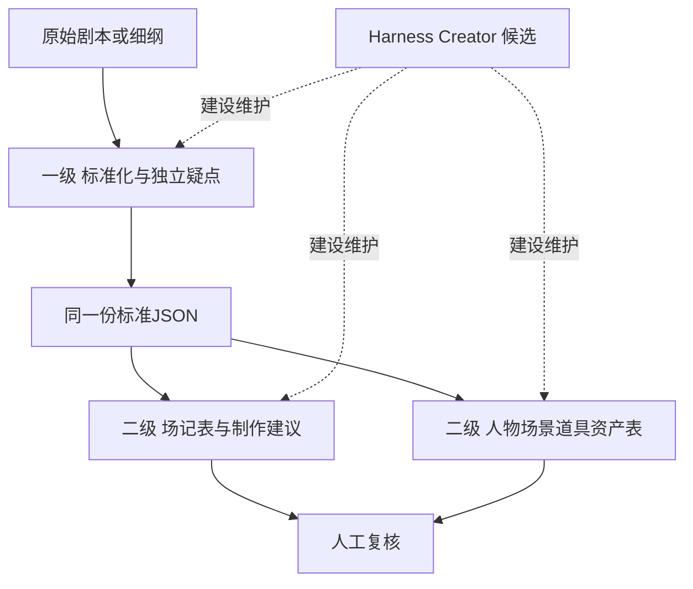
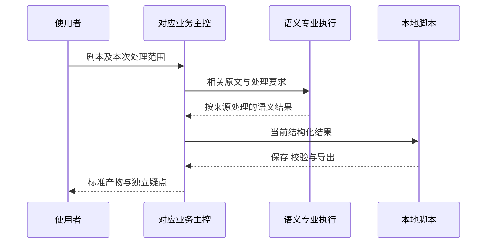
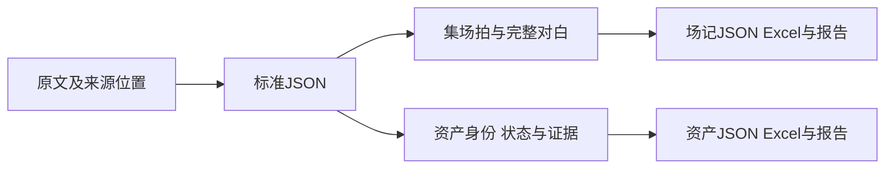

# 开宝箱工作室 · 剧本插件

三个业务插件分别负责剧本标准化、场记表和资产表；Harness Creator是额外的能力建设工具。两项二级业务读取同一份一级标准JSON，可分别运行。资产能力另见[ZiChan](https://github.com/kaibaoxiang-studio/ZiChan)，其访问权限以该仓库为准。

## 主分支当前组件（2026-11-18）

| 组件 | 当前版本 | 用途与入口 | 本次状态 |
| --- | --- | --- | --- |
| [剧本标准化](level-1/screenplay-standardization/screenplay-standardizer/README.md) | v0.1.3 | `$standardize-screenplay` / `$review-screenplay` | 同步本机原生语义委派与CLI兼容路线 |
| [场记表](level-2/scene-log-extraction/scene-log-extractor/README.md) | v0.1.1 | `$ai-continuity-sheet` | 本机原有运行时、临时会话与辅助知识更新的同步补丁 |
| [资产表](level-2/asset-extraction/screenplay-asset-extractor/README.md) | v0.4.0 | 以该组件当前Skill与README为准 | 保留仓库既有新版；不由本机较旧v0.1.2覆盖 |
| [Harness Creator](engineering/harness-creator/README.md) | v0.2.2 候选 | `$harness-creator` | 原生专业委派；Grill Me按名使用Skill Orchestrator中的版本 |

当前版本以各目录的`.codex-plugin/plugin.json`为准。`release.json`及v1.0.2标签保留历史组合发行记录，不代表主分支当前组件版本。本次只同步表中有本机增量的三项，保留资产表v0.4.0及其知识和兼容文件。

## 安装与更新

从仓库主分支注册市场可获取当前组件：

```sh
codex plugin marketplace add https://github.com/kaibaoxiang-studio/script-plugins.git
```

在Codex插件目录选择该市场并安装所需插件。若此前安装时固定了`--ref v1.0.2`，该历史标签不会自动变成新版；应切换到主分支或使用下列独立安装包。完整保留插件目录，不只复制Skill正文。

- [剧本标准化v0.1.3](https://github.com/kaibaoxiang-studio/script-plugins/releases/tag/screenplay-standardizer-v0.1.3)
- [场记表v0.1.1](https://github.com/kaibaoxiang-studio/script-plugins/releases/tag/scene-log-extractor-v0.1.1)
- [Harness Creator v0.2.2候选](https://github.com/kaibaoxiang-studio/script-plugins/releases/tag/harness-creator-v0.2.2)

独立包附README、逐文件manifest及SHA256校验值。Python与依赖要求以各包RUNTIME.md为准。Creator独立调用Grill Me需安装Skill Orchestrator；未安装时按Creator自身对齐方法处理，不伪报调用。

## 工作流







不同组件保留自身执行合同；图示不代表已实现跨插件自动调度或统一批准数据库。摄影、灯光、表演、时长及创作补全仍需按组件规则人工复核。

## 发行验证与限制

2026-11-18同步以本机实装文件为依据，完成元数据、Skill引用、Python语法、源码结构和ZIP逐文件核对；Creator有36项确定性测试通过。具体命令及范围见各发行manifest。未重新付费调用模型处理整剧，也未做Windows真机或图像效果验收。

剧本标准化与场记表的旧蓝图重建仍会产生入口或界面元数据差异；本次不使用该重建结果替换实装文件，安装包直接保留当前入口，差异明确记入manifest。维护时应先核对当前插件正文与旧生成模板，不能用旧模板无条件回写。历史业务证据仍见[1.0验证](docs/validation-v1.0.md)和[1.0.2验证](docs/validation-v1.0.2.md)，不把历史成绩转记为本次语义验收。

## 目录与维护

```text
level-1/screenplay-standardization/  一级插件及历史维护资料
level-2/scene-log-extraction/        场记插件及来源快照
level-2/asset-extraction/            资产表插件及维护资料
engineering/harness-creator/        通用插件建设候选
.agents/plugins/marketplace.json    统一市场入口
```

当前可安装实现保存在各插件目录。creator-src、历史release.json和旧标签保留其原有版本，修改时先辨明版本归属。来源和许可证见[NOTICE](NOTICE.md)、各插件THIRD_PARTY_NOTICES与随包许可证。
