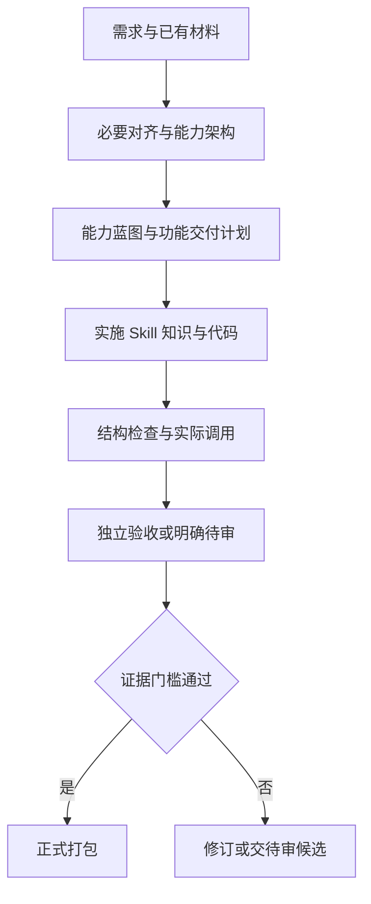
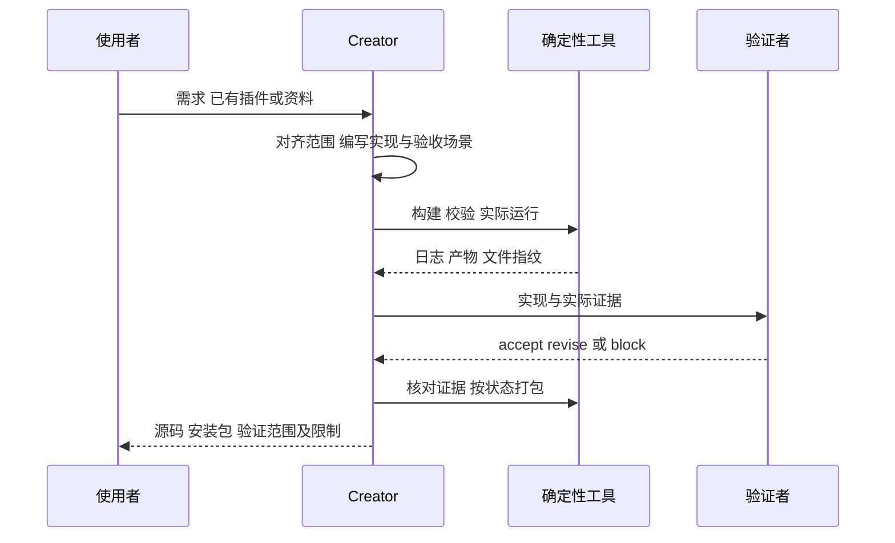
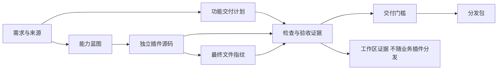

# Harness Creator v0.2.0

从业务需求创建、改造和维护可独立安装的 Codex 能力插件。**当前为候选发布版**：新增功能级交付计划与证据核对；尚未完成真实剧本业务整链和候选自身的独立验收。

Creator 是插件建设工具，不是剧本处理节点。生成插件自带运行代码、所需知识与依赖锁，使用时无需安装 Creator。`build` 组装已编写完整的蓝图，不会仅凭一句需求自动发明业务实现。

## 怎么用

```text
$harness-creator 根据我的业务需求建设插件。先复用已有资料，对齐真正影响实现的未知项，再完成能力、输入输出和验收设计。

$harness-creator 修改这个已有插件，只改变指定能力，保留用户改动和无关知识，验证后交独立安装包。

$harness-knowledge-maintainer 将这份资料的适用部分补入指定能力，保留来源，验证受影响行为。
```

主入口只在明确调用时启动，Grill Me 随包提供。架构、来源整合、Skill 编写、知识维护和验证按任务选择，不要求每次执行所有角色。

## v0.2.0 更新

| 改动 | 实际作用 |
| --- | --- |
| 功能级交付计划 | 将能力蓝图与逐项建设、完成条件、验收场景分开，不把运行 DAG 当建设计划 |
| 真实检查记录 | 记录命令、退出状态、日志与产物，不只写“已测试” |
| 验收证据核对 | 区分实施者自检与独立验收，核对日志、报告与最终文件指纹；实现变化后旧证据不能直接沿用 |
| 正式打包入口 | release-package 在证据门槛通过后打包；普通 package 可输出候选，不代表业务验收通过 |
| Agent 加载修复 | 任务提示带入已选 Skill 的准确路径和正文，减少仅凭技能名搜索造成的超时 |

不同会话标识本身不能证明审查者独立，结构检查也不能证明业务质量。协议见[功能交付与验收](skills/harness-creator/references/delivery.md)。

## 工作流







## 安装与运行

需要已登录的 Codex 本地客户端／CLI、Python **3.12+**。从本仓库 Release 下载候选 ZIP，完整解压并保留隐藏目录：

```sh
codex plugin marketplace add /absolute/path/to/harness-creator
codex plugin add harness-creator@harness-creator-local
python3 scripts/bootstrap.py --install
python3 harness.py doctor
python3 harness.py validate
```

同名市场已存在时先核对原来源，再切换；不要覆盖正在执行的插件。新版本在新聊天中加载。依赖安装到用户缓存的隔离环境，不改系统 Python。模型与登录状态来自当前 Codex 配置，不内置密钥。详见[安装说明](docs/install.md)与[RUNTIME.md](RUNTIME.md)。Python 节点运行本地代码，工作目录约定不构成操作系统安全隔离。

## 命令目录

| 范围 | 命令 |
| --- | --- |
| 构建与维护 | build、patch、revise |
| 开源来源 | discover、fetch-source、inspect-source、absorb |
| 知识维护 | knowledge-ingest、knowledge-publish、knowledge-status |
| 业务执行 | run、run-capability、resume、cancel、replay |
| 检查与候选打包 | doctor、validate、package |
| 交付与正式打包 | delivery-plan-check、capture-check、plugin-fingerprint、delivery-check、release-package |

## 验证范围

29 项确定性测试、6 能力／7 Skills 结构检查通过。历史真实调用验证了中文目录写文件，以及一个生成插件的完整 App Server 调用。本次发布重新运行测试与解包检查，见[发布复核](docs/publication-v0.2.md)。

未完成“剧本标准化→场记→资产”真实整链、原生 Windows 端到端、性能对照和本候选的独立验收。动态 DAG、租约接管、集群高可用不属于本版已实现能力。详见[原候选验证](docs/validation-v0.2.md)。

来源与许可见[THIRD_PARTY_NOTICES.md](THIRD_PARTY_NOTICES.md)。原始业务资料、私有运行日志与凭据不随包发布。
